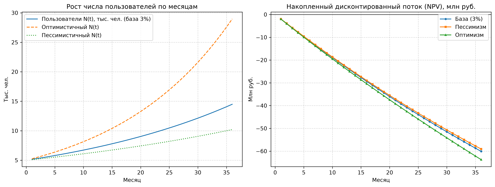

# Расчёт критической массы и ценности социальной сети («ГородСоцСеть»)

Анализ модели роста, критической массы, ценности сети по закону Мэткалфа, прибыли, `NPV`, чувствительности к темпам роста, минимального `ARPU` для безубыточности и стратегических рекомендаций для запуска социальной сети в городе с населением `1 000 000` человек на горизонте `36` месяцев (ставка дисконтирования — `12%` годовых / `1%` в месяц).

## Файлы в репозитории
- Ноутбук с расчётами и графиками (`.ipynb`) — помесячное моделирование базы пользователей, дохода, прибыли и `NPV` за 36 месяцев.
- Zadanie_2_grafik.png` — графики роста числа пользователей и накопленного дисконтированного потока (`NPV`) по сценариям.

## Основные результаты расчётов (горизонт 36 месяцев)
- **Операционный порог покрытия затрат на поддержание (`ARPU * N >= 2 000 000 руб./мес.`):** `133 334` пользователя (при росте `3%/мес.` с `5 000` пользователей этот порог достигается примерно за `112` месяцев; за `36` месяцев база достигает `~14 491` пользователя).
- **Особенность модели с платным привлечением (`CAC = 500 руб.`, `ARPU = 15 руб./мес.`):** при росте `3%/мес.` затраты на привлечение прироста на пользователя в пересчёте на базу составляют `500 * 0,03 = 15 руб.`, а при `15%/мес.` — `75 руб./мес.`, что превышает текущий `ARPU` (`15 руб./мес.`).
- **Базовый сценарий (`3%/мес.` до порога, `15%/мес.` после):** к 36-му месяцу база составляет `~14 491` чел., ценность по закону Мэткалфа `V(N_36) ≈ 1 049 945 руб.`, доход `R_36 ≈ 217 371 руб./мес.`, `NPV ≈ -60,10 млн руб.`.
- **Сценарии темпов роста (`NPV` за 36 месяцев):**
  - Пессимистичный (`2%` до / `10%` после): `~10 199` пользователей к 36-му месяцу, `NPV ≈ -59,09 млн руб.`.
  - Оптимистичный (`5%` до / `20%` после): `~28 959` пользователей к 36-му месяцу, `NPV ≈ -63,74 млн руб.`.
- **Минимальный `ARPU` для выхода в `NPV >= 0` за 36 месяцев (при росте `3%/мес.`):** `~242,55 руб./мес.` (а для покрытия ежемесячных затрат в 36-й месяц — `~152,58 руб./мес.`).

## Стратегические выводы
1. Снижать `CAC` за счёт органического и вирального роста (реферальные механики, локальные сообщества, городские афиши и партнёрства), поскольку покупка каждого нового пользователя по `500 руб.` при `ARPU = 15 руб./мес.` не окупается.
2. Повышать монетизацию (`ARPU`) через локальную рекламу, платные продвижения, сервисы и подписки, приближая доход с пользователя к порогу безубыточности.
3. Масштабировать инфраструктурные расходы (`2 000 000 руб./мес.`) поэтапно и фокусироваться на плотности аудитории в отдельных районах/кластерах города для усиления сетевого эффекта (`V = k * N^2`).

